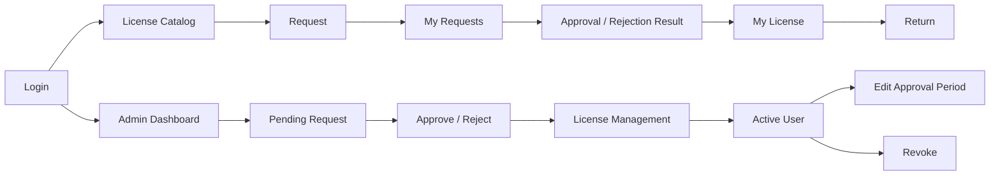

# LiChU. 프로젝트 기술서

## 1. 서비스명
LiChU.

## 2. 한 줄 소개
한정된 사내 SaaS 좌석의 신청부터 승인, 할당, 반납과 회수까지 관리하는 B2B 서비스.

## 3. 배경
기업은 여러 부서에서 GitHub Copilot, Figma, IntelliJ, Adobe CC 등을 사용하지만 좌석과 요청을 서로 다른 채널에서 관리한다.

## 4. 문제 정의
가용 좌석을 찾기 어렵고, 요청 처리가 분산되며, 불필요한 점유와 처리 사유 누락이 발생한다.

## 5. 핵심 가치
좌석 현황의 단일 기준, 명확한 처리 결과, 회수 가능한 자원, 삭제되지 않는 업무 이력.

## 6. Target User
좌석이 제한된 SaaS를 운영하는 기업의 임직원과 IT 자산관리 담당자.

## 7. Actor
USER(임직원), MASTER(관리자) 두 역할만 사용한다. 회원가입은 USER만 생성한다.

## 8. Actor별 기능
USER: 프로필 사진을 포함한 회원가입·정보 수정, 로그인, 검색·필터, 신청, 결과 조회, 취소, 사용 중 라이선스 반납.
MASTER: 로그인, 대시보드, 승인·반려, 처리 이력, 라이선스 등록·수정, 현재 사용자 검색, 권한 승인 기간 수정, 사유를 남기는 회수.

## 9. 주요 User Flow
직원은 좌석이 없어도 신청할 수 있고 관리자는 좌석 확보 후 승인한다. 승인 즉시 내부 사용 권한이 할당된다. 예정 시작일까지 할당을 지연하지 않으며 종료 예정일도 자동 회수 조건이 아니다.

## 10. 화면 구성
로그인, 회원가입, 회원 정보 수정, 탐색, 신청 모달, 내 신청, 내 라이선스, 관리자 대시보드, 신청 관리(대기/이력), 라이선스 관리, 등록·수정 모달, 사용자 검색, 권한 승인 기간 수정, 승인·반려·회수·반납 확인 모달.

## 11. UI Flow

## 12. 주요 Error Scenario
401 로그인 필요, 403 타인 자원·관리자 기능 접근, 404 없는 자원, 400 처리된 상태 재처리 또는 비활성 라이선스, 409 중복 신청·기존 할당·좌석 부족·사용량 이하 축소, 422 필드 검증 오류. 오류는 code/message/선택적 fields 형식이다.

## 13. Data Model
Department 1:N User, User/License 각각 1:N LicenseRequest 및 LicenseAssignment. Request 1:0..1 Assignment. 프로필 이미지는 User에 저장하고, 승인 시 신청 기간을 Assignment의 권한 승인 기간(valid_from/valid_until)으로 복사한다. 목적은 연결된 Request에서 조회한다. 사용량은 ACTIVE Assignment COUNT로만 집계하며 모든 상태 변경은 이력을 보존한다.

## 14. API 설계 원칙
/api REST, Pydantic 입력·출력, JWT 인증, bcrypt 해시, 역할 및 소유권 서버 검증. Router/Service/Repository를 분리한다. 승인·반납·회수·좌석 수정은 License 행을 먼저 잠가 직렬화하며 승인 및 할당 생성은 하나의 트랜잭션으로 커밋한다. 부분 유니크 인덱스로 활성 할당과 대기 신청의 중복을 방지한다.

## 15. 현재 한계
내부 사용 권한 배정이며 외부 계정을 실제 발급하지 않는다. 외부 SaaS API, HR, SSO, 알림, 자동 측정·회수, 예산, 다단계 결재, 자동 대기열, 결제는 범위에 포함하지 않는다. 토큰은 만료 시 재로그인하고 refresh token은 없다.

## 16. 향후 확장
실제 기업 적용 시 SSO/HR 기반 사용자 수명주기를 우선 검토한다. 이후 Vendor provisioning, Slack/email 알림, 측정 기반 회수, 부서 예산, 결재 단계, 대기열 자동 할당을 별도 검토한다.
